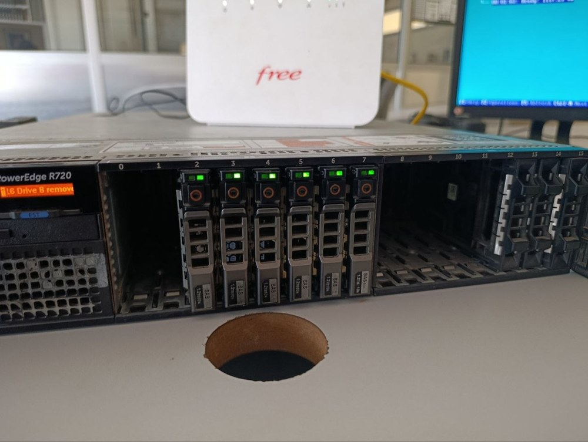
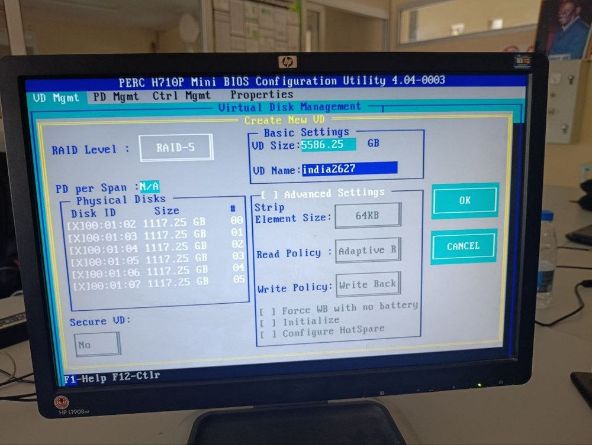
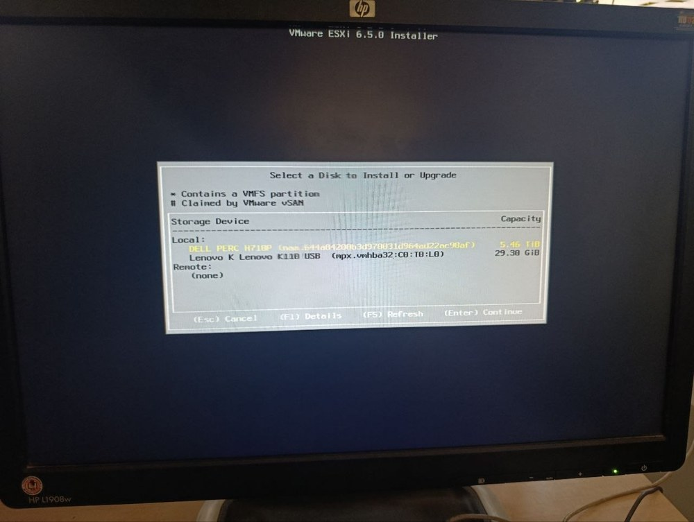
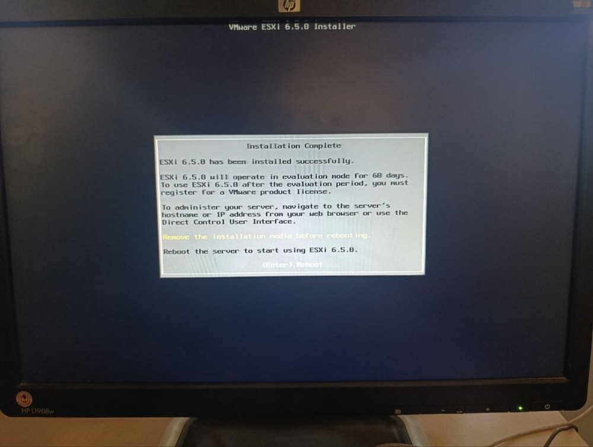

# Installation de VMware ESXi 6.5 sur Dell PowerEdge R720 (RAID 5)

Ma contribution à l'étude de cas **« Administration d'un hyperviseur VMware ESXi 6.5 »**, réalisée en équipe de 11 étudiants (module Cloud et Virtualisation, ESMT Dakar, InDIA, 2025 à 2026, encadrement de M. SOUARE).

Dans ce projet, j'étais l'**Étudiant 2** : préparation du stockage en **RAID 5**, installation de l'hyperviseur **ESXi 6.5** et vérification de son accès web. Ce dépôt ne contient que cette partie. Les autres rôles de l'équipe (conception, réseau, VLAN, machines virtuelles, sécurité, supervision, sauvegarde) font l'objet de leurs propres livrables.

## Ce que j'ai réalisé

| Étape | Résultat |
| --- | --- |
| Configuration RAID 5 sur le contrôleur PERC H710P | Volume de 5,45 To (6 disques SAS), état Optimal, défini comme disque de démarrage |
| Préparation du support d'installation | Clé USB multiboot Ventoy avec l'image ESXi 6.5 U3 DellEMC Customized A08 |
| Installation d'ESXi 6.5 | Hyperviseur installé sur le volume RAID 5 |
| Configuration réseau initiale (DCUI) | Passage d'une adresse DHCP à l'adresse statique 192.168.10.10 |
| Vérification de l'accès web | Accès au vSphere Host Client, contrôle des rubriques Stockage, Réseau, Licence et Supervision |

## Matériel

| Composant | Spécification |
| --- | --- |
| Serveur | Dell PowerEdge R720 (2U), présent sur la VMware HCL |
| Processeurs | 2 × Intel Xeon E5-2650 v2 @ 2,60 GHz |
| Mémoire | 40 Gio détectés par le VMkernel |
| Contrôleur RAID | Dell PERC H710P Mini |
| Disques | 6 × 1 117,25 Go SAS |



## Choix techniques et justifications

**RAID 5 pour le volume système.** Avec 6 disques, il tolère la panne d'un disque et conserve (6 − 1) / 6, soit environ 83 % de la capacité brute : 5 586,25 Go utiles. Le RAID 1 aurait limité la capacité à 50 %, et le RAID 6 aurait coûté un second disque de parité. Paramètres retenus : bandes de 64 Ko, Adaptive Read, Write Back.



**Image DellEMC Customized plutôt que l'ISO VMware générique.** Elle embarque les pilotes natifs du R720 (contrôleur PERC H710P, cartes réseau Broadcom). Avec l'ISO générique, le volume RAID ou les cartes réseau risquaient de ne pas être détectés à l'installation.

**Ventoy pour le support d'installation.** Une seule clé USB rend plusieurs ISO bootables sans reformatage, ce qui a permis de passer d'une image à l'autre pendant les essais.

**Adresse statique.** L'adresse obtenue par DHCP peut changer à chaque redémarrage et faire perdre l'accès web. L'adresse d'administration a donc été figée (192.168.10.10/24, nom d'hôte `LeTitan.lan`), conformément au réseau de management défini en amont.



## Difficultés rencontrées et solutions

| Difficulté | Solution |
| --- | --- |
| Aucun disque détecté par le contrôleur PERC au démarrage | Redémarrages successifs du serveur, jusqu'à la détection des 6 disques (problème intermittent d'initialisation du contrôleur) |
| 5 disques sur 6 en état « Foreign » (anciennes configurations RAID) | Foreign View puis Foreign Config, Clear : les 6 disques passent à l'état Ready |
| Hésitation entre l'ISO générique et l'ISO DellEMC | Image DellEMC Customized A08 pour la reconnaissance native du matériel |
| Adresse DHCP instable | Reconfiguration en adresse statique via la console DCUI |



## Limites

- ESXi 6.5 n'est plus maintenu par VMware (fin du support général en 2022), ce qui le limite à un usage pédagogique ou de laboratoire.
- Le matériel (Xeon E5-2650 v2) n'est pas pris en charge par ESXi 8 : une version plus récente que la 6.5 ne peut donc pas être installée sur ce serveur.
- Le RAID 5 protège contre la panne d'un disque, mais ne remplace pas une sauvegarde.

## Contenu du dépôt

```
esxi65-install-raid5-dell-r720/
├── README.md
└── docs/
    ├── Rapport_Installation_ESXi65_RAID5_Dell_R720.pdf   Rapport complet (20 pages, 23 figures)
    └── images/                                           Captures utilisées dans ce README
```

## Auteur

**Cheïck Abdoul Aziz BOUGOUM**, élève ingénieur Données et IA, ESMT Dakar
[LinkedIn](https://www.linkedin.com/in/che%C3%AFck-abdoul-aziz-bougoum-7264243aa) · [GitHub](https://github.com/cheickbougoum90-web)
